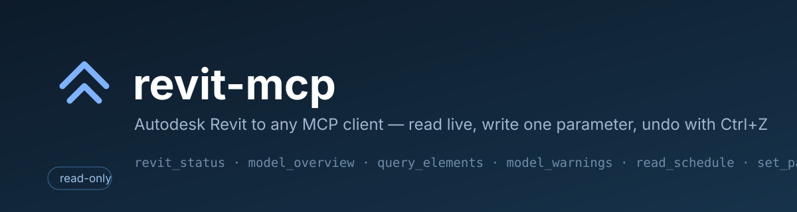
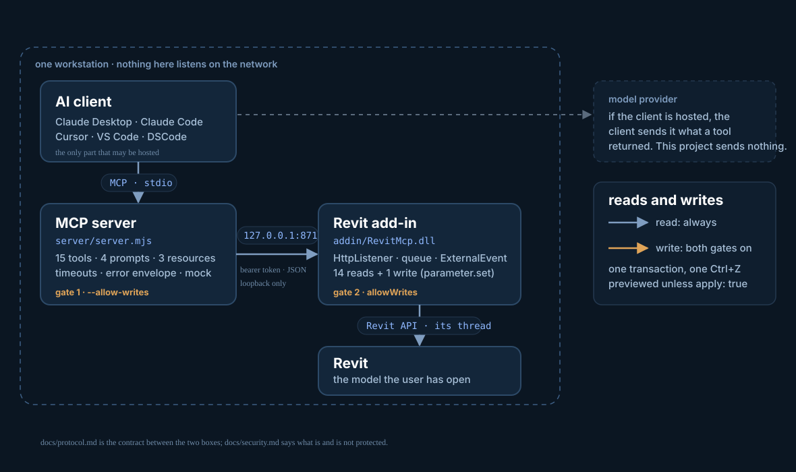
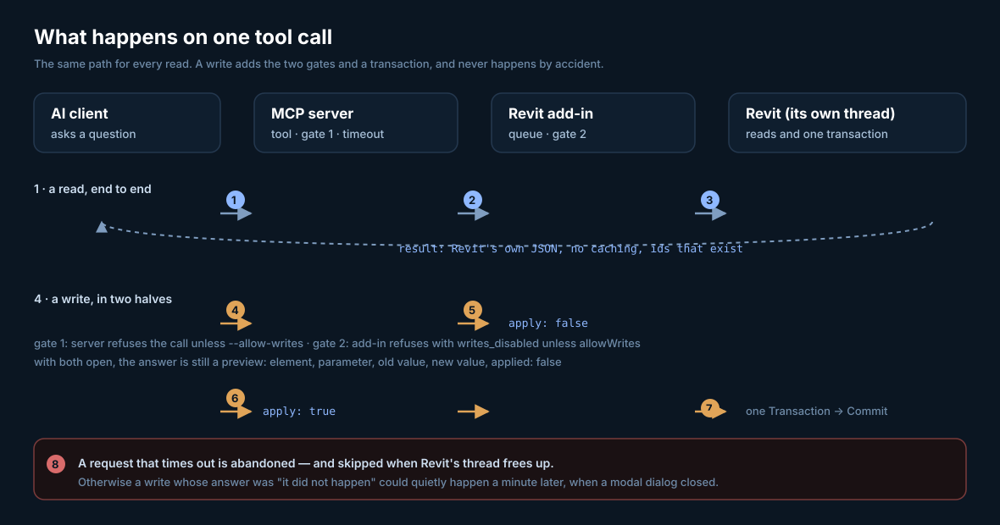

# revit-mcp: Revit MCP server for Claude, Cursor and AI assistants

[](https://github.com/constructelligence-lab/revit-mcp/actions/workflows/ci.yml)
[](LICENSE)
[](server/package.json)
[](#install-the-add-in)
[](server/README.md)



<p align="center"><strong>Connect Autodesk Revit to Claude, Cursor, VS Code and any Model Context Protocol (MCP) client: ask questions of the open BIM model, make photoreal renders and turntables, export PDF, IFC and glTF, and — only if you allow it — make small, previewed, undoable edits.</strong></p>

**revit-mcp** is an open source (MIT) MCP server and Revit add-in for Revit 2024 to 2027. The model stays on your workstation: nothing is uploaded, and the assistant gets a narrow, auditable set of tools instead of free rein over a client's building.

### What can you ask it?

- *"Which rooms on Level 2 are over 40 m², and what are their departments?"* (`list_rooms`)
- *"Take off the external wall areas by type."* (`geometry_quantities`, `wall_layers`)
- *"Do the ducts clash with the structural framing on Level 3?"* (`check_clashes`)
- *"Give me four golden-hour exterior renders, then a ray-traced version of the best one."* (`render_gallery`, `render_photoreal`)
- *"Export the issued sheets as one PDF, and the model as IFC."* (`export_model`)
- *"Make a door schedule with Mark, Type, Level and Fire Rating."* (`create_schedule`, previewed first)
- *"Which Marks are empty? Fix them one at a time."* (`parameter_audit` prompt, `set_parameter`)

Most "AI for BIM" asks you to upload a model somewhere, or to trust a cloud service with a client's building.
This does the opposite. Revit stays where it is, the data stays on the workstation, and the assistant gets a
narrow, auditable set of reads plus two small writes: off by default, previewed before it happens, applied in
a single undoable transaction.



## How it works

Two processes, because the Revit API is in-process and single-threaded: nothing outside Revit can read a
document, and nothing may touch one off Revit's thread. The **MCP server** owns the AI protocol; the
**add-in** owns the model.

| | |
|---|---|
| **AI client → MCP server** | MCP over stdio. The client is the only part that may be hosted: if it is, it sends whatever a tool returned to its provider. This project sends nothing anywhere. |
| **MCP server → add-in** | HTTP + JSON on `127.0.0.1:8712` with a bearer token, loopback only. [`docs/protocol.md`](docs/protocol.md) is the contract: routes, envelope, error codes, every op. |
| **add-in → Revit** | The Revit API, on Revit's thread. Requests are queued and marshalled with an `ExternalEvent`, so Revit finishes what it is doing first. |
| **Reads** | Always available. Live at call time, never cached: a `revit://…` resource or a tool call is a read of the document as it is now. |
| **Writes** | Two tools (`set_parameter`, `create_schedule`), two gates, preview by default, one transaction each. Neither process can open the gate alone. |

### Where everything lives

| Path | What it does |
|---|---|
| `server/server.mjs` | MCP server: registers the menu, applies the write gate, maps tools to bridge ops |
| `server/tools.mjs` · `prompts.mjs` · `resources.mjs` | The menu itself — one place, so the README, the tests and the protocol cannot drift |
| `server/bridge.mjs` | Loopback client: token discovery, timeouts, and the error messages a person reads |
| `server/mock.mjs` | The sample model that makes all of this testable without Revit |
| `addin/Bridge/BridgeServer.cs` | `HttpListener` on loopback, token check, write gate, one JSON envelope |
| `addin/Bridge/RevitDispatcher.cs` | The queue and `ExternalEvent` that put work on Revit's thread; the abandoned-request rule |
| `addin/Handlers/` | The Revit API work: reads, renders and exports (see the menu) and two gated writes (`parameter.set`, `schedule.create`) |
| `docs/protocol.md` · `security.md` · `guide.md` | The contract, the threat model, and the 20-minute guide |

Two processes, because the Revit API is in-process and single-threaded: nothing outside Revit can read a
document, and nothing may touch one off Revit's thread. The MCP server owns the AI protocol; the add-in owns
the model.

## Why this one

| | |
|---|---|
| **Read-only until *two* switches are on** | The add-in refuses writes with `writes_disabled` before any Revit work, and the server refuses to call the write tool. Neither can open the gate alone. |
| **Two writes, and both are small** | `set_parameter`: instance parameters only, preview by default, one transaction per change (one Ctrl+Z), type parameters refused with the reason. `create_schedule`: adds one schedule view, previewed first. No delete, move, save or sync anywhere. Renders and exports use temporary views that are rolled back, so they are not writes. |
| **A written contract** | [`docs/protocol.md`](docs/protocol.md) is the bridge: every op, argument, result and error code. Tests fail when the catalogue and the docs disagree. |
| **Testable without Revit** | A sample model behind the same bridge means the tools, prompts, resources and failure modes are covered in CI on Linux, macOS and Windows — 43 tests, no Windows required. |
| **It compiles against the real API** | The add-in builds against the genuine Revit reference assemblies, so the API misuse a CI run would catch is caught without a Revit licence. |
| **An honest threat model** | [`docs/security.md`](docs/security.md) says what is protected *and* what is not (the token file, provider egress, why read-only is still a disclosure). |
| **Numbers come from Revit** | Every figure is a live read at call time. No caching, no copy of the model, no invented ids: ids come from `query_elements` or `current_selection`. |

## Try it in 30 seconds (no Revit)

```sh
git clone https://github.com/constructelligence-lab/revit-mcp
cd revit-mcp/server
npm install
npm run demo        # a real MCP transcript against the sample model
```

```
revit-mcp demo — sample model, no Revit required

tools (28):     revit_status, model_overview, list_levels, … render_scene, render_gallery,
                render_photoreal, render_turntable, export_model, list_rooms, project_structure,
                geometry_quantities, check_clashes, create_schedule, set_parameter
prompts (5):    model_health_check, quantities_from_schedules, sheet_qa, parameter_audit,
                presentation_renders
resources (3):  revit://status, revit://model/overview, revit://warnings

{ "mock": true, "revit": { "version": "2025.2", "document": "Sample Tower.rvt",
  "units": "millimeters", "workshared": true, "activeView": "L2 - Floor Plan" },
  "writesAllowed": false, "levels": 3 }
```

Every sample answer carries `"mock": true`, so it can never be mistaken for a live building.

## Install the add-in (Windows + Revit)

```powershell
cd revit-mcp\addin
dotnet build -c Release        # Revit 2025/2026 -> net8.0-windows; 2027 -> net10.0-windows; 2024 -> net48
copy bin\Release\net8.0-windows\RevitMcp.dll            %APPDATA%\Autodesk\Revit\Addins\2025\
copy bin\Release\net8.0-windows\manifest\RevitMcp.addin %APPDATA%\Autodesk\Revit\Addins\2025\
```

Build commands for every release, including the two-step net48 build, are in [addin/README.md](addin/README.md).

Start Revit, open a model, and the **revit-mcp** tab tells you the address, whether writes are allowed, and
where the token is. Full detail, including Revit 2024 and two versions side by side, in
[addin/README.md](addin/README.md).

## Connect your client

```json
{ "mcpServers": { "revit": { "command": "node",
  "args": ["/path/to/revit-mcp/server/server.mjs"] } } }
```

That shape works for Claude Desktop, Cursor, Windsurf, VS Code, DSCode and most others; Claude Code is
`claude mcp add revit -- node /path/to/revit-mcp/server/server.mjs`. Every client, plus environment
variables and the Windows path variants: [docs/clients.md](docs/clients.md).

To allow writes, add `--allow-writes` **and** set `"allowWrites": true` in
`%APPDATA%\revit-mcp\settings.json`, then restart both. Either switch alone leaves the bridge read-only.

<!-- Generated from server/tools.mjs by `npm run tools:table` — do not edit by hand. -->
## The menu

| Tool | What it does | Changes the model |
|---|---|---|
| `revit_status` | Is Revit open, which document is active, its units and worksharing state, and whether the add-in will accept writes. Call this first when anything else fails: it tells you whether the bridge is up at all. | no |
| `model_overview` | The model at a glance: file name, Revit version, level, sheet and view counts, the biggest categories by element count, and how many warnings Revit is holding. Start here for "what is in this model". | no |
| `list_levels` | Every level with its elevation and how many elements sit on it, so you can see what the model is organised around. | no |
| `list_categories` | Model categories with instance counts — walls, doors, windows, rooms, furniture and anything else the model uses. | no |
| `query_elements` | Find elements by category, level, family, type or a parameter value. Returns a compact row per element (id, category, family/type, level, mark) — the ids are what element_details, set_parameter and the other element tools take. | no |
| `element_details` | One element in full: instance and type parameters, family/type, level, host, workset and bounding box. Use it before set_parameter to see what a parameter is called and what it holds now. | no |
| `list_views` | Views in the model (floor plans, sections, 3D, schedules) with their type, level and sheet, if placed. | no |
| `list_sheets` | Sheets with number, name and the views placed on them — the drawing set as issued. | no |
| `list_families` | Loaded families with how many types each carries and how many instances are placed. | no |
| `model_warnings` | Revit's own warnings (rooms not enclosed, duplicate instances, overlapping walls) with the elements they point at. A warning is a prompt to look, not a defect finding. | no |
| `list_schedules` | Schedule views in the model — quantities, door schedules, room schedules, sheets of data. | no |
| `read_schedule` | The rows and columns of one schedule as it computes them, for quantities and take-off questions. Header names are Revit's; totals rows are marked as such. | no |
| `current_selection` | What the user has selected in Revit right now. The fastest way to answer "this wall" — ask, then work from these ids. | no |
| `export_view_image` | Render a view (the active one by default) to a PNG file and return its path and size, so a picture can be read alongside the data. Writes an image file in a temp folder; it never changes the model. | no |
| `scene_info` | What a camera needs to know before it is placed: the building's bounds in the document's length unit, true north, the site (latitude and longitude, so sun studies are real), levels with elevations, rooms with their centre points, and the 3D views that already exist. Call this before render_scene with explicit coordinates; render_scene with a preset calls it for you. | no |
| `render_scene` | Make a picture of the model from a camera you choose, and get the image back so you can look at it. Pick a preset (exterior corner, aerial, elevation, top plan, or interior of a room) or give an explicit eye and target; add a mood (golden_hour, overcast…) or an exact sun date and time, a sky, a visual style, hidden categories or a section box. Judge the result and iterate: move the camera, change the mood, hide what blocks the view. It builds a temporary 3D view and rolls it back, so the model, its views and its undo stack are unchanged; the only lasting effect is an image file. Uses Revit's own visual styles: a good presentation still, not a ray-traced render. | no |
| `render_gallery` | Several pictures in one go, for a presentation set: the same mood and style from a list of presets (default: four exterior corners). Up to six. Each image comes back so you can pick the best, and say which and why. Same guarantees as render_scene: nothing in the model changes. | no |
| `list_rooms` | Rooms with number, name, level, department, area (m²), perimeter and volume, plus the total area. Pass boundaries: true for each room's boundary loops (start and end points of every segment) when you need the shape, for finishes or take-off. Unplaced and unenclosed rooms are not listed. | no |
| `project_structure` | How the project is organised, one kind at a time: grids (with end points), links (Revit links with loaded state, and CAD links/imports), phases, design options, worksets (owner, open, editable; only in workshared models) or revisions (number, date, description, issued). Read-only. | no |
| `list_materials` | Materials in the model with class, colour, transparency and whether they carry a rendering appearance. Use it before choosing what to call a finish. | no |
| `wall_layers` | The layered build-up of a wall, floor, roof or ceiling element: each layer's function, material and thickness, and the total. Give the id of an element of that type (from query_elements). | no |
| `geometry_quantities` | Count, area (m²), volume (m³) and length by type for one category, optionally on one level, from Revit's own computed values, so they agree with the model's schedules. Use it for quick take-offs of walls, floors, slabs and framing when no schedule exists; read_schedule is better when one does. | no |
| `check_clashes` | Geometric intersections between two categories in this document, e.g. Ducts against Structural Framing. Returns pairs with ids and levels. Intersecting is a prompt to look, not a defect: a door intersects its wall by design. Does not look into links. Large models are sampled (the answer says so). | no |
| `export_model` | Write the model out as a file on the Revit machine: pdf (sheets), dwg (sheets or views), ifc (IFC4) or gltf (3D geometry with materials, for Blender, Unreal or Twinmotion). Returns the file paths. Nothing in the model changes: temporary views are rolled back. Name sheets by number to avoid exporting the whole set. | no |
| `render_photoreal` | A physically-based, ray-traced picture of the model, made on this machine: the add-in exports the geometry and materials, then Blender (Cycles) renders it with a physical sky, the sun placed from the model's real latitude, the date and time, real glass, ground, filmic colour, bloom and vignette. Same camera options as render_scene (a preset, or eye and target). It is much slower than render_scene: use quality draft to compose the shot, standard or final once it is right. Needs Blender installed (or BLENDER_PATH set). The model is not changed. | no |
| `render_turntable` | A turntable: the camera orbits the building at the height and distance of the chosen shot, rendered by Blender as a frame sequence (and an MP4 if ffmpeg is installed). Slow: each frame is a full render, so use quality draft and 24 to 36 frames first. Returns the folder, and a still from the middle so you can check the framing. | no |
| `create_schedule` | Make a new schedule of one category with the columns you name (parameter names, as Revit calls them). Preview by default (apply: false): it checks the fields exist and lists the ones that do, so fix names first; with apply: true it adds the schedule view in one transaction, one Ctrl+Z removes it. Requires writes to be enabled on both the server and the add-in. Adds a view to the model, so say what you will create and get a yes before applying. | **yes** — preview by default |
| `set_parameter` | Change one parameter on one element. Preview by default (apply: false) and returns the old and new value; with apply: true it runs in a single Revit transaction, so one Ctrl+Z undoes it. Requires writes to be enabled on both the server and the add-in, and never touches type parameters that would change every instance. | **yes** — preview by default |

### Workflow prompts

| Prompt | The workflow it writes out |
|---|---|
| `model_health_check` | Read the model the way a BIM manager would on a Monday: sizes, warnings, what is on each level, what stands out. |
| `quantities_from_schedules` | Take-off numbers for an estimate, read from the schedules the model computes, with the caveats a quantity surveyor would want. |
| `sheet_qa` | Check what was issued: sheets, their views, revisions, and anything printed that should not have been. |
| `parameter_audit` | Find empty Marks and other unpopulated identity data, then preview the fix one element at a time — nothing is written without a yes. |
| `presentation_renders` | A client-ready set of pictures of the open model: plan the shots, render them, look at each one, fix what is wrong and pick the best. |

### Live resources

| Resource | What a client gets |
|---|---|
| `revit://status` | Which document is open, the Revit version, and whether the bridge will accept writes. Read this before blaming a tool for failing. |
| `revit://model/overview` | Counts and the biggest categories in the open model — the same answer model_overview gives. |
| `revit://warnings` | Revit's own warnings for the open model, live. A warning is a prompt to look, not a finding. |
<!-- end menus -->

`revit_status` first, then `model_overview`; ids come from `query_elements` or `current_selection`, never
from the model's imagination. A call with no `apply: true` changes nothing.

## Pictures: renderings a client can judge

Ask for a picture and the assistant gets the **image itself**, not a path, so it can look, say what is weak,
and re-shoot. `render_scene` takes a named shot or an explicit camera; `render_gallery` takes a set.

```text
"Make a client set of the tower at golden hour, four exterior corners, then the best aerial and the
 main meeting room. Look at each one and tell me which two you would send."
```

| You choose | Options |
|---|---|
| **Shot** | `exterior_ne/nw/se/sw`, `aerial_*`, `front/back/left/right`, `top`, `interior` (a room by name, number or id, and which way to look), or your own `eye` and `target` |
| **Light** | `mood`: `day`, `morning`, `golden_hour`, `overcast`, `winter`; or an exact `sun` (month, day, local hour, intensity) at the model's real site |
| **Look** | `style` (realistic, shaded, consistent colours, hidden line, wireframe), `background` sky, `outlines`, `width` up to 4000 px, `format` |
| **Clean-up** | `hide_categories` (furniture, planting, site) and a `section_box` to open one floor |

The camera maths (corner diagonals, aerial height, eye height in the room's own level, unit conversion) is in
[`server/camera.mjs`](server/camera.mjs) and is tested without Revit. In Revit the add-in builds a throw-away
3D view, dresses it, exports it and **rolls the transaction group back**: the model, its views and its undo
stack are as they were, so rendering is not behind the write gate. The `presentation_renders` prompt runs the
whole routine: plan, shoot, look, fix, choose.

> **Honest limits.** These are Revit's own visual styles with real sun and shadows: crisp presentation
> stills, not ray-traced photorealism (Revit's Render command is not exposed by its API). The add-in is
> compiled against the real Revit 2024–2027 API in CI; the render path has not yet been run against a live
> Revit session by the author, so treat the first renders on your machine as the real test and open an issue
> with what Revit says if one is off.

## Photoreal renders with Blender

`render_scene` is Revit's own visual style: fast, and good for composing a shot. For a picture that looks
like a photograph, `render_photoreal` hands the model to **Blender (Cycles)** on the same machine:

1. the add-in exports the 3D geometry and Revit's materials as glTF (`export_model` does the same on request);
2. the server computes the **sun from the model's real latitude**, the date and the time (`mood` or an exact `sun`);
3. Blender renders with a physical sky, real glass, a ground plane, AgX colour, a soft bloom and a vignette,
   with `quality` `draft` (about a minute), `standard` or `final`, on CPU or `gpu: true`.

`render_turntable` orbits the camera round the building and writes a frame sequence, plus an MP4 if `ffmpeg`
is installed. Install Blender (free, blender.org) or set `BLENDER_PATH`; nothing is uploaded anywhere. Details,
limits and the settings: [docs/rendering.md](docs/rendering.md).

## What a session looks like

One call, end to end — the same path for every read, and the two extra steps a write takes:




```jsonc
// query_elements { "category": "Doors", "parameter": "Fire Rating", "value": "90" }
{ "category": "Doors", "total_matched": 6, "scanned": 18,
  "rows": [ { "id": 100037, "category": "Doors", "family": "Double-Flush",
              "type": "1830 x 2134mm", "level": "L1", "mark": "D-100" } ] }

// set_parameter { "element_id": 100043, "parameter": "Mark", "value": "D-999" }   ← no apply
{ "element_id": 100043, "element": "Single-Flush: 0915 x 2134mm", "parameter": "Mark",
  "old_value": "D-105", "new_value": "D-999", "applied": false,
  "note": "Preview only. Nothing changed — call again with apply: true to make this change." }
```

Five worked workflows — model health check, quantities from schedules, sheet QA, parameter audit, and reading
a rendered view — are in [docs/guide.md](docs/guide.md), and four of them ship as prompts.

## Documentation

| | |
|---|---|
| [docs/guide.md](docs/guide.md) | The 20-minute guide, five workflows, the house rules, troubleshooting |
| [docs/protocol.md](docs/protocol.md) | The bridge contract: routes, envelope, error codes, every op |
| [docs/security.md](docs/security.md) | What is protected, what is not, and the settings to use by situation |
| [docs/clients.md](docs/clients.md) | Every client config, environment variables, the mock |
| [docs/faq.md](docs/faq.md) | Safety, cloud models, Revit versions, why so few write tools |
| [docs/roadmap.md](docs/roadmap.md) | What is next, and what is deliberately not planned |

## What it deliberately does not do

- **No create, delete, move or type changes to the model.** One instance parameter at a time, previewed, in one
  transaction; anything else is a decision for a person in Revit.
- **No save, sync or worksharing operations.** The bridge edits the open model; it never writes the file.
- **No IFC or cloud (ACC/BIM 360) access.** It reads the document Revit has open, which may be ahead of or
  behind what the rest of the team sees.
- **No QA verdict.** Warnings and counts are Revit's; the sentence built from them is the model's. Not an
  audit, not a compliance record.

## Development

```sh
cd server && npm install
npm test              # 43 tests: catalogues, bridge failure modes, end-to-end MCP over stdio, write gate
npm run demo          # the transcript above, for real
npm run tools:table   # regenerate the menus in this README
npm run check:docs    # fail if they are out of date (CI runs this)

cd ../addin && dotnet build    # compiles against the real Revit 2025 reference assemblies
```

CI runs the server on Node 20 and 22, builds the add-in against Revit 2025, 2026 and 2027 plus .NET Framework
4.8, and fails on documentation drift. See [CONTRIBUTING.md](CONTRIBUTING.md) for how to add a tool, and
[SECURITY.md](SECURITY.md) for reporting.

## How it compares to other Revit MCP servers

Several open source Revit MCP servers exist, and some are older, more widely used and more capable at
changing models than this one. Figures below are from the GitHub API on 2026-11-09; read their READMEs
for what they do today.

| Project | Licence | Stars | Approach |
|---|---|---|---|
| [mcp-servers-for-revit/revit-mcp](https://github.com/mcp-servers-for-revit/revit-mcp) | MIT | 477 | TypeScript server; tools that create, modify and delete Revit elements |
| [mcp-servers-for-revit/mcp-servers-for-revit](https://github.com/mcp-servers-for-revit/mcp-servers-for-revit) | MIT | 433 | A fork of the above with more tools and Revit 2020 to 2026 build targets |
| [HorizunGroup/horizun-revit-mcp](https://github.com/HorizunGroup/horizun-revit-mcp) | Apache-2.0 | 82 | Windows installer with the runtime included; Revit 2023 to 2027 |
| [bimwright/rvt-mcp](https://github.com/bimwright/rvt-mcp) | Apache-2.0 | 120 | Revit 2022 to 2027 |
| **constructelligence-lab/revit-mcp** (this) | MIT | 1 | Read-only until two switches are on; photoreal renders and turntables through Blender; PDF, IFC and glTF export; a sample model so everything is testable without Revit |

**Choose this one** if you want the assistant to read and picture a model without being able to edit it by
default, or you want renderings. **Choose another** if you need the assistant to build or delete model
elements, or you want a packaged installer: this project currently has neither (you build the add-in with
`dotnet build`), and its add-in has not yet been run against a live Revit by its author.

## Frequently asked questions

**Does it work with Claude Desktop, Claude Code and Cursor?** Yes: any MCP client that can launch a stdio server. See [docs/clients.md](docs/clients.md).

**Which Revit versions are supported?** Revit 2024 (.NET Framework 4.8), 2025 and 2026 (.NET 8) and 2027 (.NET 10). CI builds all four against the real Revit API.

**Is my model sent anywhere?** No. The add-in listens on loopback only. A hosted AI client sees only what a tool returns to it; see [docs/security.md](docs/security.md).

**Can it change my model?** Not unless you turn writes on in two places. Even then, the only writes are `set_parameter` and `create_schedule`, both previewed first and undoable with one Ctrl+Z.

**Can it make photorealistic renderings?** Yes, with Blender installed: `render_photoreal` and `render_turntable` export the model and render it with Cycles. See [docs/rendering.md](docs/rendering.md).

**Is it an official Autodesk product?** No. Revit and Autodesk are trademarks of Autodesk, Inc.; this project is independent.

**Can I try it without Revit?** Yes: `npm run demo` runs the full tool set against a sample model.

## Licence

MIT — see [LICENSE](LICENSE). The Autodesk Revit API assemblies are Autodesk's, referenced at compile time and
never redistributed. Revit and Autodesk are trademarks of Autodesk, Inc.; this project is not affiliated with
or endorsed by Autodesk.

Built by [Constructelligence](https://constructelligence.co) — the same people who write the
[AI in construction guide](https://github.com/constructelligence-lab/ai-in-construction-guide).
